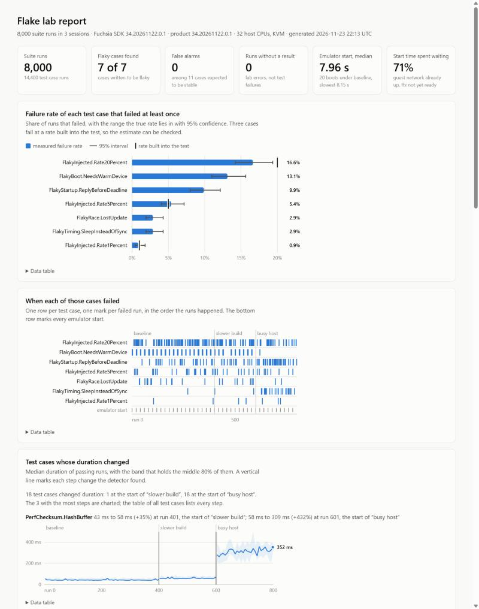

# flake-lab

A small lab for measuring flaky tests on Fuchsia. It runs a suite of Fuchsia
test components hundreds of times on the Fuchsia emulator, records every run,
and then says which tests are flaky, how often they fail, what the failures
have in common, and which tests got slower.

Some of the tests are flaky on purpose, each for a different, documented
reason. That gives the detector something to be checked against.

## Result

In 14,400 test case runs on the Fuchsia emulator, the lab flagged all 7 tests
that were written to be flaky and none of the 11 controls. A single retry would
have reported 86% to 100% of the failures of six of those seven tests as
passes.



The data comes from three sessions on one machine on 23 November 2026: 800
iterations of ten test components, 8,000 suite runs, 40 emulator boots, 27
minutes of run time. No run was lost to a lab error. The full text report
and the dashboard for these sessions are in `results/2026-11-23/`.

| Session | Iterations | What changed |
|---|---|---|
| baseline | 400 | nothing |
| slower build | 200 | `PerfChecksum` built with `--define=flakelab_regression=1` |
| busy host | 200 | the slower build, plus 64 busy-loop processes on the 32-CPU host |

### Flaky tests

| Test case | Failed / runs | Rate | 95% interval | First failure at run | Failures that passed on the next run |
|---|---|---|---|---|---|
| `FlakyInjected.Rate20Percent` | 133 / 800 | 16.6% | 14.2% to 19.4% | 9 | 86% |
| `FlakyBoot.NeedsWarmDevice` | 105 / 800 | 13.1% | 11.0% to 15.6% | 1 | 29% |
| `FlakyStartup.ReplyBeforeDeadline` | 79 / 800 | 9.9% | 8.0% to 12.1% | 49 | 90% |
| `FlakyInjected.Rate5Percent` | 43 / 800 | 5.4% | 4.0% to 7.2% | 12 | 91% |
| `FlakyRace.LostUpdate` | 23 / 800 | 2.9% | 1.9% to 4.3% | 36 | 100% |
| `FlakyTiming.SleepInsteadOfSync` | 23 / 800 | 2.9% | 1.9% to 4.3% | 271 | 100% |
| `FlakyInjected.Rate1Percent` | 7 / 800 | 0.9% | 0.4% to 1.8% | 105 | 100% |

The 11 control cases never failed in 800 runs each, which puts their failure
rate below 0.5% with 95% confidence.

**Built-in rates.** Two of the three intervals contain the rate built into the
test (5% and 1%). The third does not: the 20% case measured 16.6%. To find out
whether the test or the estimate was off, that component was run 3,000 more
times on its own and measured 21.0%, 5.2% and 1.0%. The miss is therefore read
as chance, which a 95% interval allows one time in twenty.

**Patterns found.**

- `FlakyBoot.NeedsWarmDevice` fails early after a boot: the median failure came
  14 suite runs after an emulator start, the median pass 114 runs after one
  (p = 1e-54). This is the cause written into the test. It is also why a retry
  hides only 29% of its failures: the next run is still too soon after boot.
- Under a busy host `FlakyTiming.SleepInsteadOfSync` went from 1 failure in 400
  runs to 20 in 200, and `FlakyStartup.ReplyBeforeDeadline` from 27 in 400 to
  37 in 200. Both are timing bugs, so this is the expected direction.
- `FlakyBoot.NeedsWarmDevice` almost stopped failing under a busy host (1 in
  200). The emulator took 16 s to start there, so the device was already
  "warm" when the first test ran. A test can get more reliable when the
  infrastructure gets slower, which is worth knowing before trusting a green
  run.
- No pattern was reported for the injected cases or for the data race. For the
  injected cases that is correct: their failures are independent by design.

**Durations.**

- The slower build was located at the right run: `PerfChecksum.HashBuffer` went
  from 43 ms to 58 ms (+35%) starting with the first iteration of the "slower
  build" session. No other case was flagged there.
- At the first iteration of the "busy host" session, all 18 cases were flagged
  as slower, by 37% to 600%.
- One more step was reported inside the busy session, for
  `StableMath.SumOfFirstMillion` (68 ms to 78 ms, p = 5.5e-4). Its cause was
  not investigated.

### What the lab showed about the tooling

These were measured along the way and are separate from the flake detection.

- **Running a suite costs 72 ms once the package repository is registered.**
  That is the mean host wall-clock time of `ffx test run` over the 6,000 runs
  on a quiet host. A `bazel test` of a two-test sample package took 10.5 s on
  the same machine (one measurement, Fuchsia's SDK samples), because each
  invocation creates, publishes, registers and deletes a repository.
- **An emulator start takes 8.0 s, and the guest's own boot is about 1.5 s of
  it.** Medians over the 20 baseline boots: 0.75 s before the guest kernel
  starts, 1.5 s until the guest's network is up, then 5.6 s until
  `ffx emu start` returns. Under the busy host the median start was 16.4 s.
- **The guest could not be reached sooner by waiting differently.** In a
  separate experiment (`experiments/emu_ready.py`, 12 boots per method) no ffx
  command got an answer before 6.0 s of guest uptime. The built-in wait
  returned after 7.9 s every time. Polling `ffx target echo` every 100 ms got
  in after 6.9 s in 5 boots but only after 11.1 s in the other 7, so it was
  slower on average. Why the guest is unreachable for those 6 s was not
  established. Its log shows the IPv4 address being added with duplicate
  address detection requested, which would fit, but that was not tested.
- **Start times come in steps.** Across the sessions they clustered near 6.8 s,
  8.0 s and 14 s. The source of `ffx emu start` checks the guest with a 6 s
  timeout and sleeps 1 s between attempts, which matches those steps.
- **gtest cases cannot leak state into each other on Fuchsia.** The gtest
  runner starts a new process per test case, so the usual order-dependent
  flake could not be reproduced.
- **Connecting to a component before it has started is safe.** The request
  waits in the channel. The start-up flake had to be built from a client-side
  deadline instead.

## The test suite

Ten test components, eighteen test cases. All are C++ gtest binaries built
with Bazel and the Fuchsia SDK.

| Test case | Why it fails | Expected rate |
|---|---|---|
| `FlakyInjected.Rate20Percent`, `Rate5Percent`, `Rate1Percent` | Draws from the kernel CPRNG and fails at a fixed probability | 20%, 5%, 1% by construction |
| `FlakyRace.LostUpdate` | Two threads increment an unsynchronised counter | Not known in advance; about 5% when tuned |
| `FlakyTiming.SleepInsteadOfSync` | Waits 1.1 ms for a worker that needs 1 ms, instead of joining it | About 1% on a quiet host |
| `FlakyStartup.ReplyBeforeDeadline` | A client component gives up after 95 ms on a child component whose start-up takes 0 to 100 ms | Roughly 7% |
| `FlakyBoot.NeedsWarmDevice` | Fails while the device has been up for less than 10 s, standing in for a dependency that is slow to become ready | Depends on how often the emulator restarts |
| `PerfChecksum.HashBuffer` | Never fails. Built with `--define=flakelab_regression=1` it does 50% more work | Stable |
| `StableMath.*`, `StableZircon.*`, `StableThreads.*`, `StableTimer.*` (10 cases) | Controls: computation, Zircon channels, VMOs and events, correctly synchronised threads, a sleep with only a lower bound | Never |

The sources are in `tests/`; each file starts with a comment that explains its
mechanism. `lab.toml` records the expectations so the detector can be scored.

A separate host-driven suite adds five more cases that run on the host and
drive the device through ffx. It is described under
[Host-driven tests](#host-driven-tests).

## Host-driven tests

Fuchsia's end-to-end framework, Lacewing, runs Mobly tests on the host that
control the device through a library called Honeydew. The SDK ships neither,
so `host_tests/` rebuilds the same shape from public parts: Mobly test classes,
a small Mobly controller (`ffx_device.py`) and ffx as the transport.

| Test case | What it does |
|---|---|
| `DeviceTest.test_remote_control_echoes` | Sends a string through the remote control service and checks the reply |
| `DeviceTest.test_uptime_advances` | Reads the device's monotonic clock twice |
| `DeviceTest.test_core_components_exist` | Lists components and looks for three that must exist |
| `DeviceTest.test_log_message_reaches_the_device_log` | Writes a unique marker to the device log and reads it back |
| `FlakyHostTest.test_echo_within_budget` | Flaky on purpose: asserts that an echo round trip takes under 33 ms |
| `RebootTest.test_soft_reboot_restores_remote_control` | Reboots the device and checks that its clock reset. Not part of repeated runs, because a reboot disturbs the other tests |

The runner executes a host suite like any other suite and stores its cases in
the same tables, so the report and the dashboard work unchanged.

Setup, once (on Ubuntu this needs the `python3-venv` package):

```sh
python3 -m venv .venv
.venv/bin/pip install -r requirements-host.txt
```

Two sessions were recorded on 23 November 2026, in a database of their own:

```sh
python3 -m flakelab --db out/host/host.sqlite run --config lab-host.toml \
    --iterations 300 --restart-every 30 --label baseline
python3 -m flakelab --db out/host/host.sqlite run --config lab-host.toml \
    --iterations 100 --restart-every 25 --label "busy host" --host-stress 64
python3 -m flakelab --db out/host/host.sqlite report --config lab-host.toml
```

Result: 400 suite runs, 2,000 test case runs, none lost to a lab error.

- The four controls never failed.
- `FlakyHostTest.test_echo_within_budget` failed 13 times in 300 runs on a
  quiet host (4.3%) and 100 times in 100 on a busy one. The detector reported
  the difference between the two conditions (p = 2e-80).
- All four controls were flagged as slower from the first busy run, by 196% to
  283%.
- A suite run of five cases took 275 ms at the median on a quiet host and
  948 ms on a busy one.
- The reboot test was run once by hand and passed in 7.3 s.

## How it works

```
tests/ (Bazel, Fuchsia SDK)          flakelab/ (Python, standard library only)
  .far packages  ───────────────►  runner ──► ffx emu / ffx repository / ffx test
                                      │
                                      ▼
                                   SQLite: session, boot, run, test_case
                                      │
                         ┌────────────┴────────────┐
                         ▼                         ▼
                  text report               static dashboard
```

**Runner.** Builds the packages, starts a headless emulator, serves the
packages from a local repository and calls `ffx test run` once per test
component per iteration. The emulator is restarted every N iterations, which
both produces boot-time samples and exposes tests that depend on time since
boot. A session can be given a build variant (`--define`) and a number of
busy-loop processes on the host (`--host-stress`), so that a condition changes
at a known point.

**Store.** One SQLite file with a row per session, emulator boot, suite run
and test case. A run that yields no result file is stored as `INFRA_ERROR` or
`RUNNER_TIMEOUT` and is never counted as a test failure.

**Analysis.** Per test case:

- *Verdict.* Flaky means it both passed and failed on the same build. The
  failure rate comes with a Wilson 95% interval.
- *Pattern.* Whether failures sit early or late after a boot (Mann-Whitney),
  whether the rate differs between sessions (Fisher exact), and whether
  failures come with higher host load (Mann-Whitney). Reported at p < 0.01
  with a minimum effect size.
- *Retries.* The share of failures that passed on the very next run, which is
  what a retry-once policy would have hidden.
- *Duration.* Step changes in the duration of passing runs (Pettitt's test,
  applied recursively, p < 0.001 and a shift of at least 10%), and runs more
  than three times slower than the median.

Emulator starts are split into three parts using the guest's own clock and
serial log: time before the guest kernel starts, guest boot until its network
is up, and the remaining wait until `ffx emu start` returns.

**Dashboard.** `python3 -m flakelab dashboard` writes one self-contained HTML
file with the data embedded. It needs no server and no network.

## Running it

Requirements: Linux x86-64 with usable `/dev/kvm` (developed on Ubuntu 24.04
under WSL2), `git`, `unzip`, `python3` 3.11 or newer, about 15 GB of disk for
the Bazel cache. Without KVM the emulator did not finish booting in ten
minutes.

```sh
git clone --recurse-submodules https://github.com/norumander/flake-lab
cd flake-lab
scripts/bootstrap.sh                 # downloads Bazel into tools/
tools/bazel build //tests/...        # first build fetches the SDK and clang
```

Fetch a product bundle that matches the pinned SDK (`34.20261122.0.1`):

```sh
FFX="$(tools/bazel info output_base)/external/fuchsia_infra++cipd_ext+fuchsia_sdk/tools/x64/ffx"
"$FFX" product download \
  gs://fuchsia-public-artifacts-release/builds/8664478884851215441/product_bundles/minimal.x64/transfer.json \
  ~/pb/minimal.x64
```

`ffx` sends usage analytics unless told otherwise:
`"$FFX" config analytics disable`.

The three sessions behind the results above:

```sh
python3 -m flakelab run --iterations 400 --restart-every 20 --label baseline
python3 -m flakelab run --iterations 200 --restart-every 20 --label "slower build" \
    --define flakelab_regression=1
python3 -m flakelab run --iterations 200 --restart-every 20 --label "busy host" \
    --define flakelab_regression=1 --host-stress 64

python3 -m flakelab report          # text
python3 -m flakelab dashboard       # out/dashboard.html
python3 -m unittest discover -s flakelab -t . -p '*_test.py'
```

## Layout

| Path | Contents |
|---|---|
| `tests/stable/` | Control tests |
| `tests/flaky/` | Deliberately flaky tests; `startup/` is the two-component one |
| `tests/perf/` | The test with a slower build variant |
| `flakelab/runner.py`, `emulator.py`, `ffx.py` | Session loop, emulator and repository handling |
| `flakelab/db.py`, `results.py` | SQLite schema, parsing of ffx result files |
| `flakelab/stats.py`, `analysis.py`, `report.py` | Statistics, verdicts, text report |
| `flakelab/dashboard.py`, `dashboard_template.html` | Dashboard |
| `host_tests/` | Mobly tests that drive the device from the host, and their controller |
| `experiments/emu_ready.py` | The emulator readiness measurement quoted above |
| `lab.toml`, `lab-host.toml` | What to run, and what each test is expected to do |
| `manifests/` | CIPD pins for the SDK, the Bazel rules and clang |
| `results/2026-11-23/` | Reports and dashboards from the recorded sessions |

## Limits

- One machine (Windows 11 with WSL2), one SDK version, one product bundle, one
  afternoon. Nothing here says how the numbers move elsewhere.
- The flaky tests are synthetic. They show that the method recovers causes
  that are known; real flakes are messier.
- With 800 runs per case, a 1% flake produced 7 failures. A test that fails
  less than about once in 300 runs would probably have been called stable.
- The patterns are statistical associations at p < 0.01, tested for seven
  cases and three kinds of pattern, with no correction beyond the strict
  threshold. They are leads to follow up, not proofs.
- The "busy host" session differs from the baseline in two ways, build variant
  and host load. The build variant only touches `PerfChecksum`, so the changes
  in failure rates are attributed to load.
- Case durations are derived from start times and are whole milliseconds.
- The split of emulator start time relies on the wording of two guest log
  messages.
- The host-driven suite uses Mobly and ffx, not Honeydew, so it shows the
  structure of a Lacewing test rather than Lacewing itself. Its results are a
  separate, smaller dataset from the three sessions above.

## Licence and credits

Apache License 2.0; see `LICENSE`.

The Bazel module setup is adapted from Fuchsia's
[SDK samples](https://fuchsia.googlesource.com/sdk-samples/getting-started),
which are BSD-licensed. `third_party/fuchsia-infra-bazel-rules` is a submodule
of Fuchsia's own repository and keeps its own licence.
